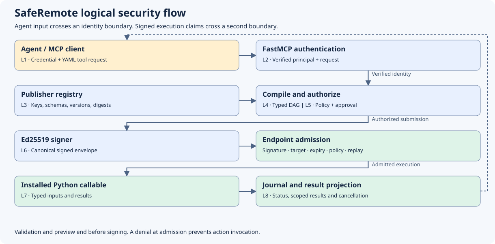
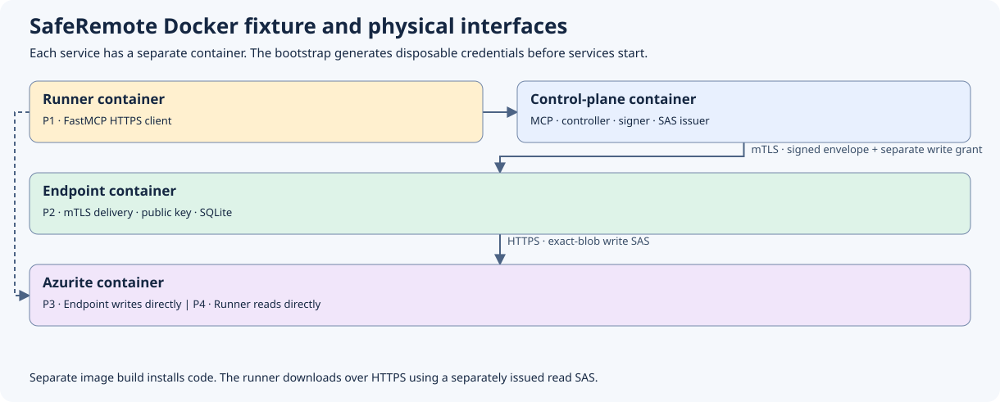

# XP Libs SafeRemote

Compile declarative YAML into signed plans for registered Python callables. The
`xp-libs-saferemote` distribution exposes the `remote_intent` SDK. Its core
works independently of MCP and language models.

The SDK supports signed observation workflows and opt-in, policy-governed data
export through registered actions. Endpoint admission denies mutating and
privileged operations. The in-process worker runs trusted publisher code under
the endpoint process's OS identity.

## Architecture and trust boundaries



| Interface | What crosses it and what is checked |
| --- | --- |
| L1 · Client to FastMCP | MCP tool arguments carry YAML, a catalog fingerprint and a submission key. The deployment's authentication callback verifies the HTTP credential. |
| L2 · FastMCP to controller | Verified principal and workflow request. The controller filters target and action visibility. Credentials stay at the ingress layer. |
| L3 · Registry to compiler | Publisher-registered action keys, versions, schemas, implementation digests and effects. Discovery exposes the caller-visible contracts. |
| L4 · Compiler to policy | A typed plan with resolved action contracts, dependencies and execution order. Validation and preview stop before signing or dispatch. |
| L5 · Policy and approval | Controller policy evaluates the principal and plan. A required receipt is bound to the exact execution, plan, principal, expiry and policy scope. |
| L6 · Controller to endpoint | The adapter delivers canonical JSON signed with Ed25519. The endpoint verifies signature, target, freshness, installed contracts, current policy and replay state. |
| L7 · Worker to action | Validated arguments and trusted action context. The endpoint resolves references and rechecks policy before invoking the registered callable. |
| L8 · Endpoint to caller | Principal-scoped status and projected results return through the adapter. Cancellation is a separate authenticated request toward the endpoint. |

The controller owns the private signing key. The endpoint owns the trusted
public keys, installed registry and SQLite journal. The signature authenticates
the execution claims. A deployment supplies a confidential, authenticated
delivery channel through the transport interface. Action installation,
execution requests and data retrieval are separate interfaces.

## Docker end-to-end example



The deterministic agent uses real MCP over HTTPS. A controller container signs
the plan and sends it over mTLS to a separate endpoint container. The endpoint
collects synthetic local data and runs a publisher-registered export action.
It writes directly to Azurite with an exact-blob write SAS. After success, the
runner requests a separately authorized read SAS and downloads from Azurite.
The runner verifies the downloaded bytes, SHA-256, length, ETag and permissions.

```console
docker compose -f tests/e2e/docker-compose.yml --profile e2e up --build --abort-on-container-exit --exit-code-from e2e-runner
docker compose -f tests/e2e/docker-compose.yml --profile e2e down -v --remove-orphans
```

Use a fresh Compose stack for each run. See the [Docker runbook](docs/DOCKER_E2E_EXTERNAL_EXPORT.md)
and the [export effect decision](docs/adr/0002-data-export.md). The
[end-to-end security walkthrough](docs/END_TO_END_SECURITY_WALKTHROUGH.md)
includes the workflow YAML, trust boundaries, and deployment responsibilities.

## Run the example

From the repository root, with Python 3.11 or later:

```console
python -m pip install .
python -m examples.demo
```

The example registers two consumer actions with strict Pydantic models. One
returns an execution-scoped artifact handle, and the other reads it and returns
a summary. See [the registration](examples/sample_actions.py) and
[the workflow](examples/summarize.yaml).

## Integrate the SDK

1. Register trusted Python functions with `@action` and `ActionRegistry.install`.
   Supply a content digest verified by the action deployment process.
2. Configure an inventory target, controller signing key, endpoint trust store
   and independent policy adapters. With default policy, execution is denied.
3. Use `WorkflowCompiler` to validate and inspect a workflow. Use `Controller`
   for admission and `EndpointRuntime` to verify deliveries and execute through
   a trusted worker. Implement `TransportAdapter` for the selected delivery service.
4. Install the `mcp` extra and use `remote_intent.mcp.create_server` with the
   host's authentication callback. Agents discover actions and read their
   current schemas before constructing YAML.

The SDK validates plan signatures, target, validity window, catalog fingerprint,
local action identity and policy before invoking a callable. The endpoint stores
replay state in SQLite. On restart, stop all workers before quarantining
interrupted runs with `Journal.recover_exclusive()`. Inline result export
requires an explicit projection function.

See the [workflow schema](docs/generated/workflow.schema.json),
[error index](docs/generated/ERROR_CODES.md), [agent skill](skills/remote-intent/SKILL.md),
[security policy](SECURITY.md) and [release setup](docs/GITHUB_SETUP.md).

## Develop

```console
python -m pip install -c requirements-lock.txt -e ".[dev,mcp,llm-eval,e2e]"
ruff check .
ruff format --check .
mypy src examples
python -m pytest
```

The [local model runbook](docs/LOCAL_LLM_RUNBOOK.md) describes the optional
fake-endpoint evaluation.
