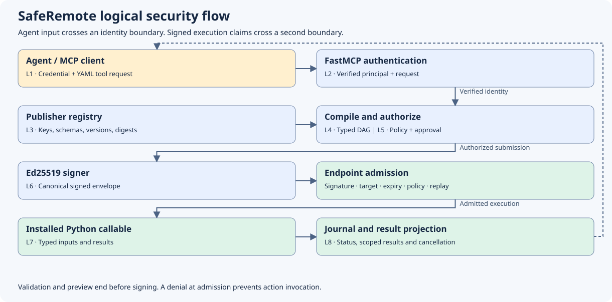
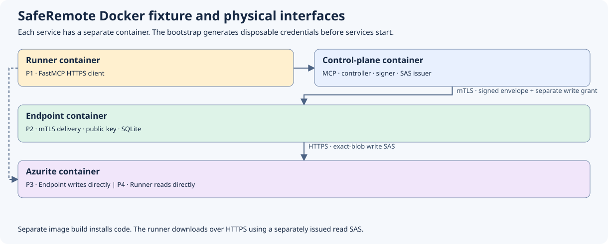

# SafeRemote end-to-end security walkthrough

Use this guide for a one-hour architecture review. Spend 10 minutes on the
boundaries, 15 on the runnable example, 20 tracing admission and execution,
and 15 on failure modes and deployment responsibilities.

## What SafeRemote controls

SafeRemote controls which **already deployed Python callable** may execute on
which endpoint, with which typed arguments, under whose authority. Your
existing systems can continue to provision code, inventory targets, and move
data. The SDK gives the model a way to request work and gives the endpoint
enough authenticated context to decide independently whether to perform it.

The publisher registers a callable, a versioned key, strict Pydantic input
and output models, and an implementation digest. Deployment metadata and
policy define the action's effect and target eligibility. Treat these as trusted
code, including Pydantic validators and the result projector. Literal inputs can
reach validators during compilation, so validators must be side-effect-free.
The model operates on the published contract and supplies workflow data.





| Boundary | Interface | Information crossing it |
| --- | --- | --- |
| Agent → control plane | FastMCP over HTTPS in the fixture | Transport credentials, action discovery, workflow YAML, catalog epoch, idempotency key, and execution ID |
| Control plane → policy and approval | `PolicyEvaluator` and `ApprovalProvider` | Authenticated principal, compiled plan, resource scope, policy revision, and an approval binding where required |
| Control plane → endpoint | `TransportAdapter`, implemented with mTLS in the fixture | Signed plan bytes, fixture export grant on a separate field, and principal-scoped status, results, and cancellation |
| Endpoint → action | Registered Python callable through an endpoint worker | Validated input model, execution context, cooperative cancellation, scoped artifacts, and deployer-provided services |
| Endpoint → storage | Publisher action using Azure Blob API over HTTPS in the fixture | Write SAS for one blob and evidence bytes |
| Agent → storage | Read SAS and Azure Blob API over HTTPS in the fixture | Read access to one object and the evidence bytes |

The logical diagram numbers the SDK interfaces L1 through L8. L1 and L2
separate the incoming credential from the verified principal. L3 and L4
join the request to registered contracts and compile the graph. L5 makes
the authorization and approval decision. L6 transfers the signed decision to
the endpoint. L7 is the first boundary where a callable can execute. L8
returns scoped metadata and carries control requests such as cancellation.
The physical diagram adds the independent blob paths outside those SDK
interfaces.

The control plane can inspect workflow inputs and the result projection.
The endpoint worker and storage can see the evidence. MCP carries an opaque
object reference, receipt metadata and, on a separate authorized request in
the fixture, a confidential read grant. The evidence file itself travels
directly between endpoint, storage and authorized reader.

## Run the reference deployment

Use a checkout of the repository and Docker in Linux-container mode. The
fixture uses separate containers for the agent runner, controller, endpoint,
bootstrap, and Azurite. Bootstrap creates disposable credentials. The
controller and endpoint install the SDK from the wheel built in Docker.
The endpoint receives the evidence fixture. Service ports stay on the
internal Compose networks.

```powershell
docker compose -f tests/e2e/docker-compose.yml --profile e2e up --build --abort-on-container-exit --exit-code-from e2e-runner
docker compose -f tests/e2e/docker-compose.yml --profile e2e down -v --remove-orphans
```

The second command removes the disposable stack, credentials, journal and
report volumes. Read the runner output first. The successful scenario reports
two action invocations and one blob. The fixture contains three JSON Lines
records, 116 bytes including LF line endings, with SHA-256
`5ab816b2fb820428ed20054088819bb6f2fe7de2d930c8ed27291acb2589dea1`.
Use the exact Git fixture bytes when comparing that digest.

The runner discovers the target's current actions and validates the examples
against their advertised schemas. The following is its workflow in YAML form.
The action keys and destination are available only where that action pack is
installed and the publisher exposes them.

```yaml
apiVersion: remote.intent/v1
kind: Workflow
metadata:
  name: investigate-and-export-evidence
spec:
  target:
    device_id: e2e-endpoint-01
  steps:
    - id: collect
      uses: test.evidence.collect@1
      with:
        fixture_id: diagnostic-sample-01
        max_records: 100
    - id: export
      uses: test.evidence.upload_blob@1
      with:
        source:
          ref: steps.collect.outputs.artifact
        destination: investigation-evidence
  outputs:
    evidence:
      ref: steps.export.outputs.object_ref
    checksum:
      ref: steps.export.outputs.content_sha256
    size:
      ref: steps.export.outputs.size_bytes
    etag:
      ref: steps.export.outputs.etag
```

### Agent and MCP host

1. The host attaches its deployment-issued credential to the HTTPS request.
   The model selects tool arguments. Keep the credential in the host transport.
2. Read the installed MCP skill resource. Call `list_actions(target_id)` and
   then `describe_action(target_id, name)` for each action. Use the returned
   input and output schemas to build the YAML and save the current catalog
   epoch. Refresh discovery on epoch drift.
3. Send `workflow_yaml` and `catalog_epoch` to `validate_workflow` and
   `preview_execution`. Inspect the compiled shape, effects and preview
   policy result. Both phases execute zero actions.
4. Send the same arguments plus a stable `idempotency_key` to
   `submit_workflow`. Reuse that key when retrying the same request. If the
   client receives a typed error, consult `get_error_info(code)` for the
   canonical explanation. Check execution status before deciding how to
   handle an uncertain outcome.
5. Poll `get_execution_status(execution_id)`, then call
   `get_execution_results(execution_id)`. Use
   `cancel_execution(execution_id)` if needed. Cancellation is cooperative
   and cannot undo a side effect that already committed.
6. The fixture adds `get_artifact_access(execution_id, object_ref)` to the
   server. The authorized client obtains a read-only SAS, reads directly from
   storage, and verifies the bytes, length and ETag against the receipt.
   A host can perform this step without disclosing the SAS to the model.

The MCP adapter uses **FastMCP** and is optional. The core SDK works without
MCP or an LLM. A host can also call the controller directly in Python and
must supply a principal obtained through its own trusted authentication path.
See the [agent runner](../tests/e2e/agent_runner.py) and
[MCP adapter](../src/remote_intent/mcp.py).

Inside the reference deployment, the runner's host code uses this shape.
`owner_token` and `tls_context` come from the test bootstrap; in your
integration they come from your credential store and CA configuration.

```python
from fastmcp import Client
from fastmcp.client.transports import StreamableHttpTransport

transport = StreamableHttpTransport(
    "https://control-plane:8443/mcp",
    headers={"Authorization": f"Bearer {owner_token}"},
    verify=tls_context,
)
async with Client(transport) as agent:
    listing = await agent.call_tool(
        "list_actions", {"target_id": "e2e-endpoint-01"}
    )
    # Check status and inspect each selected action before composing YAML.
    epoch = listing.structured_content["data"]["catalog_epoch"]
```

### Control plane

`create_server(controller, authenticate)` takes an async FastMCP-context
callback returning a verified principal string or `None`. The fixture
compares a bearer header against disposable credentials. An enterprise host
can read `get_http_headers(include={"authorization"})` and validate its own
credentials with its identity provider. For a JWT, verify the signature,
issuer, audience, validity window and applicable tenant before deriving the
principal. If a trusted gateway injects an identity header, strip any incoming
copy and authenticate the gateway-to-service hop. Host-level authentication
should cover MCP connection, resource and discovery exposure where required.
YAML and tool argument maps cannot set the authenticated principal.

The parser turns the YAML into a bounded typed workflow. It rejects duplicate
keys, aliases, anchors, tags and merge keys. The compiler resolves each
versioned action against the current target catalog, checks strict input
contracts, validates output references and dependencies, and constructs a
`CompiledPlan`. Its fingerprint binds the workflow and the resolved action
and schema identities. This is a serializable data structure describing the
requested execution graph. Action implementation code comes from the local
registry at the endpoint.

The policy evaluator decides whether that principal may use the target and
actions with the requested limits and resources. The deployer defines the
rules. A decision includes an access state, a revision, resource scope, and
timeout. The default policy denies. Authentication establishes the subject.
Authorization establishes which operation that subject may request.
`requires_approval` adds a separate decision by the configured approval
system. The approval binding covers principal, plan fingerprint, policy
revision, sorted resources, execution ID and expiry. The provider validates
the receipt against that binding and can enforce revocation. Preview is a
point-in-time assessment. Submit re-evaluates the decision before signing.

The controller assigns an execution ID and nonce, sets the validity window,
and constructs the `rir.plan/v1` execution payload. It includes the principal,
compiled plan, policy revision, resources and any verified approval receipt.
The signer signs canonical UTF-8 JSON for the object containing the key ID and
payload. The envelope adds the Base64-encoded signature. The algorithm is
**Ed25519**, the EdDSA signature scheme implemented here by Python's
`cryptography` package. The controller holds the private key. The endpoint
looks up the corresponding public key in its trust store. Any change to the
signed claims invalidates the signature. Rotate keys through the deployed
trust store and controller configuration.

The `TransportAdapter` interface exposes `deliver_plan`, `status`, `results`
and `request_cancel`. An adapter maps the approved inventory target to a
trusted delivery address, applies transport authentication, and maps delivery
and response semantics. Keeping it separate lets the same compiler, policy
and signature checks run over an enterprise delivery system or the fixture's
mTLS service. The endpoint still verifies the envelope even when the
transport has authenticated its sender. See [controller](../src/remote_intent/controller.py),
[signature and trust store](../src/remote_intent/security.py), and
[transport interface](../src/remote_intent/transports.py).

### Endpoint

The endpoint authenticates the canonical envelope, checks the target and
validity window, and recompiles it against its installed action registry.
It verifies the resulting fingerprint and independently checks policy,
resource scope and approval. The SQLite journal atomically claims the
execution ID and nonce. Identical delivery attaches to the existing record.
Conflicting reuse is denied. Keep the endpoint journal on protected durable
storage for the intended replay window and operational recovery model.

The worker runs registered actions after their dependencies settle. The
runtime validates resolved arguments and rechecks policy before invocation.
The collect action returns a scoped artifact handle. Only a consumer in the
same execution can resolve it. The handle represents in-memory bytes and is
validated against its scope and digest. The export action obtains a
deployment-supplied service lease through `ActionContext.services`. The
endpoint requires explicit `allow_data_export=True` and passing policy for
that effect. Privileged and mutating effects are denied by this release's
runtime. The in-process worker shares the endpoint process privileges.
Use a suitably isolated worker and OS identity for production action code.

In the fixture, the controller issues a short-lived blob write SAS. The mTLS
delivery carries the grant separately from the signed envelope. The endpoint
checks the grant against the admitted principal, target, execution ID, step,
plan fingerprint, destination and expiry before turning it into a service
lease. Storage enforces SAS object scope and permissions. The export uses
conditional creation and returns a receipt. If an upload might have committed
but no receipt arrived, the runtime records reconciliation required and
avoids automatically issuing another write. An operator reconciles against
the known object and execution record.

Read delegation is a separate decision. The fixture checks ownership,
successful status, the exact opaque object reference and the stored receipt
before issuing the read grant. A read SAS is a bearer secret until expiry.
Keep it out of prompts, logs, audit records and error payloads. See
[endpoint service](../tests/e2e/endpoint.py),
[grant binding](../tests/e2e/delivery.py) and
[registered actions](../examples/action_packs/evidence_export/actions.py).

## Cryptographic boundaries

| Mechanism | Security property | Operational responsibility |
| --- | --- | --- |
| Ed25519 plan signature | Authenticates the controller's claims and detects tampering | Protect the private key, pin trusted public keys, and manage rotation, clock skew and incident response |
| TLS | Protects data in transit and authenticates the server | Validate hostnames and certificate chains; secure proxies, trust roots and termination points |
| Mutual TLS | Authenticates both controller and endpoint on the fixture delivery hop | Restrict acceptable client identities and certificate issuers |
| SHA-256 | Identifies compiled claims, schemas, implementations and evidence for equality checks | Establish the trusted baseline through signed or independently trusted metadata and verify deployer-supplied code digests |
| Blob SAS | Delegates limited storage operations for a specific object and time | Issue minimal permissions, protect the bearer URL, enforce short expiry and reconcile ambiguous writes |

Signature verification and hashing leave the payload readable to anyone who
obtains it. TLS supplies confidentiality on the illustrated hops. The core
does not encrypt data at rest. Configure endpoint volumes, logs, backups and
storage-service encryption under the deployment's controls. Keep plan-signing,
transport TLS, and storage-issuer keys separated. The fixture reuses its
controller Ed25519 key for its demonstration catalog signature. Production
deployers can use distinct key lifecycles for catalog publication and execution
authorization.

## Defend the design

| Review question | Answer and trade-off |
| --- | --- |
| Why register actions? | The security review focuses on a finite set of versioned capabilities and typed contracts. Adding behavior requires a reviewed publisher deployment. |
| Why compile on both sides? | The controller gives early errors and policy context. The endpoint checks the request against what is actually installed. Catalog and policy changes can cause safe failures that require fresh discovery and submission. |
| Why sign over mTLS? | mTLS authenticates a connection. A signature binds the exact authorization claims through serialization, queues or a relay. Signing adds trust-store and key-rotation responsibilities. |
| Why isolate transport? | Enterprise delivery systems can reuse the SDK without changing authorization logic. An adapter still has to enforce trusted routing, delivery limits and authenticated responses. |
| Why scope approvals and storage grants? | Approval for one request and access to one object do not imply authority over another. Fine-grained grants require a trusted issuer and reliable execution metadata. |
| What if a registered callable is compromised? | It already has its worker's authority. Review deployment provenance and isolate worker processes, credentials, network and filesystem access. Schema validation cannot contain arbitrary trusted code. |
| What if delivery or a write is ambiguous? | Check the durable execution record and reconcile external state. The endpoint replay ledger reduces duplicate admission. The controller's default submission-key tracking is process-local, so durable cross-replica deduplication needs a deployment design. |

The Docker test proves the actual wheel can execute across FastMCP, HTTPS,
mTLS, SQLite and Azurite. Negative cases assert zero action or blob effects
for validation, preview and denied submissions, and exercise replay,
cross-principal access, storage permissions and an uncertain export. Unit
and contract suites cover parser, schema, signature, policy and runtime
rejections. The emulator supplies protocol evidence. Before operating on
production data, validate the real identity provider, approval and transport
adapters, worker sandbox, storage IAM and revocation, restart/recovery
behavior, and storage audit and retention requirements.

Related contracts and evidence are in the [SDK reference](SDK.md),
[Docker runbook](DOCKER_E2E_EXTERNAL_EXPORT.md),
[validation guide](VALIDATION.md) and
[endpoint isolation decision](adr/0001-endpoint-isolation.md).

For the smallest Python-only integration, run `python -m examples.demo`
from the repository root after installing the package. The example builds
the registry, `WorkflowCompiler`, `EndpointRuntime` and `Controller`
explicitly, then calls `controller.compile` and `await controller.submit`
using `FakeTransport`. Its source makes a useful starting point when wiring
your own adapters. See [the complete Python demo](../examples/demo.py).
